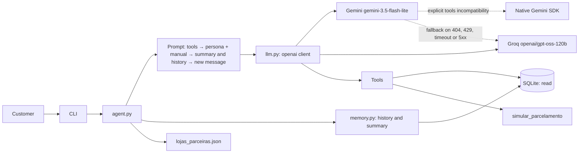

<!-- Responsibility: describe the agent's planned architecture, its flows, modules and security controls. -->

# Empório Agent Architecture

## Overview

The agent receives messages through the CLI, builds the prompt and talks to an LLM provider through a common interface. The intent classifier exists as a standalone utility but is not connected to the service flow. The layer uses the `openai` package client with a provider-specific `base_url` for Gemini or Groq; if Gemini's OpenAI-compatible endpoint explicitly rejects function calling, it uses Gemini's native SDK. Fallback switches to the other provider on model/endpoint not found (404), rate limit (429), timeout or 5xx; authentication/request errors (4xx except 404/429), validation errors and tool-execution errors do not trigger fallback.

The model chooses between answering from the policies and calling tools with fixed parameters. The tools query SQLite in read-only mode. History and calls are recorded by `memory.py`; beyond 20 unsummarised messages, the module may request a summary through a callback, keeping the 10 most recent messages in full and storing the limit in `conversations.summarized_until_message_id`. The original messages are preserved.

## Flow of a message

1. The interactive CLI associates each message with the conversation given by `--conversa`, or creates a conversation and shows its ID so it can be resumed.
2. The tool definitions are sent separately; the messages follow this order: persona, rules and manual → contextual summary (when present) → recent history → new message.
3. `llm.py` calls the main provider through the `openai` client configured with the matching `base_url`; an explicit tools incompatibility on Gemini triggers its native adapter. Gemini's `thought_signature` is carried back in memory during the function-calling round trip, on both the compatible and the native path.
4. On a 404, 429, timeout or 5xx error, the agent tries the backup provider. Other 4xx errors, tool errors and validation errors do not trigger fallback.
5. The model may request a tool. `agent.py` validates the arguments against Pydantic schemas, internally injects the conversation ID into the order tools, and runs read queries on SQLite or a deterministic calculation in code. Known validation/execution errors return a safe structure to the model.
6. Opening-hours policies are in the manual loaded by the prompt. `loja_aberta()` is an internal date/time helper; there is no `horario_loja()` tool in the current flow.
7. Instalment questions use `simular_parcelamento()`; the LLM interprets the result and does not compute instalments mentally.
8. Accessory requests are redirected using only the names and sites in `data/processed/lojas_parceiras.json`, without claiming a real partnership.
9. The answer and the provider used are recorded. In long conversations, the summary and the summarised-message limit are kept in `conversations.summary` and `conversations.summarized_until_message_id`.

## Responsibility per module

- `config.py`: settings, `agora()`, `hoje()`, `loja_aberta()` and the store time zone.
- `db.py`: SQLite connections, authorizer and read/write separation.
- `schema.sql`: store and agent tables, including conversation summary fields.
- `schemas.py`: Pydantic models for the tool arguments.
- `prompts.py`: persona, rules, out-of-scope handling, format, and composition of the summary/history in the context sent to the model.
- `llm.py`: OpenAI-compatible clients, native adaptation for Gemini function calling when incompatible, and transient fallback.
- `agent.py`: bounded tool-calling loop and final answer, with an injectable model interface for tests independent of the providers.
- `intent.py`: standalone multi-label classification by rules, with an LLM only when in doubt; not called by the current agent flow.
- `policies.py`: the only access to the manual through `get_policy_context()`; policies are kept in `data/processed/politicas.md`.
- `memory.py`: creation of conversations, isolated recording and retrieval of messages/tool calls, redaction of sensitive arguments, and summary coordination through an injectable callback.
- `cli.py`: interactive command-line interface, conversation/debug options and text presentation of the answers.
- `tools/`: catalogue, promotion and order tools, and deterministic instalments (`simular_parcelamento`).
- `data/processed/lojas_parceiras.json`: explicitly illustrative list for accessory redirection.

`loja_aberta()` applies the hours described in §2: Monday to Friday, 09:00 to 18:00; Saturday, 09:00 to 13:00; Sunday closed. Holidays are not modelled. This helper is not called by the agent to answer messages.

## Data model

- Store tables: `categories`, `products`, `promotions`, `customers`, `orders`, `order_items`.
- Agent tables: `conversations`, `messages`, `tool_calls`.
- `conversations.summary` holds the summary; `summarized_until_message_id` records the message up to which it was produced.
- `conversations.verified_customer_id` keeps the verified identity and `verification_attempts` limits invalid attempts per conversation.
- `orders.total_brl` remains the official value; `total_needs_review` flags a discrepancy.
- `installments` may be NULL for single-payment methods.
- The session keeps the verified `customer_id`; it is never supplied as an argument by the model.

## Providers

The main model is Gemini Flash-Lite (`gemini-3.5-flash-lite`) and the backup is Groq (`openai/gpt-oss-120b`), both configurable through environment variables. The implementation uses the `openai` package with each provider's OpenAI-compatible endpoint. If Gemini returns an explicit error indicating that function calling is not supported, only that call moves to the native SDK. The fallback logic is tested without network; real provider calls have so far covered only part of the adversarial scenarios (some inconclusive because of 429 limits), so compatibility and credentials still need a complete controlled real call.

## Layered security

- Tools use a read-only connection and queries with listed columns.
- `set_authorizer` blocks access to `products.description_raw` and `customers.phone`; identity verification may read `customers.email`.
- The verified `customer_id` is kept in the session and is not a tool argument.
- `description_raw` is blocked and phone/e-mail fields are not returned by the tools. The cancellation reason comes from `orders.notes` and is passed on as text; before feeding that column with real data, personal data must be filtered.
- Tool arguments are validated with Pydantic; errors return a controlled structure.
- History writes are isolated in `memory.py`.
- Date/time is obtained through `agora()`/`hoje()`, avoiding local clocks scattered through the code.

## Decisions and trade-offs

- Manual function calling keeps the flow explicit and avoids framework abstraction.
- Keeping the manual in the prompt allows direct answers and prompt caching; hybrid RAG is a future evolution, not part of the initial implementation.
- History is summarised, keeping recent messages in full; the size/limit strategy will be validated during implementation.
- Instalment calculations live in the tool so that the LLM does not invent values or compute conditions mentally.
- The accessory store list is an example list, not a claim of a commercial partnership.
- The LLM layer keeps a single contract; the planned exception is moving only Gemini to the native SDK if the compatible endpoint fails.
- The loop allows up to five tool rounds and then one final call without tools; if the model insists on requesting tools or returns no text, a fixed safe answer is used.

## Open for validation

- Final categories and possible classifier adjustments after testing.
- Tool-calling compatibility of Gemini and Groq on the selected endpoints, in a complete real run.
- Official limits and prices of the providers and the name of the cached-tokens field in the Gemini endpoint.
- Official confirmation of the contacts and a possible authorised list of partner stores.

## Evolution

- RAG with hybrid BM25 + embeddings search.
- FastAPI and real authentication.
- Classifier with `scikit-learn`, planned for Step 18.
