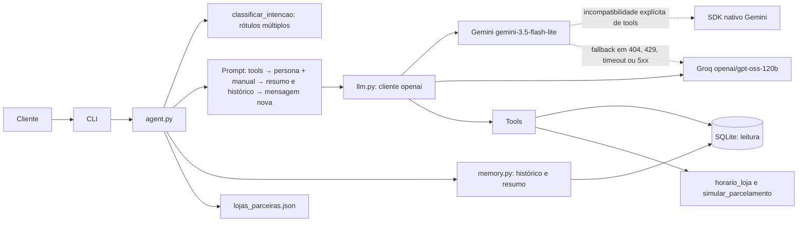

<!-- Responsabilidade: descrever a arquitetura planejada do agente, seus fluxos, módulos e controles de segurança. -->

# Arquitetura do Empório Agente

## Visão geral

O agente recebe mensagens pela CLI, classifica intenções, monta o prompt e conversa com um provedor de LLM por uma interface comum. A camada usa o cliente do pacote `openai` com `base_url` específico para Gemini ou Groq; se o endpoint OpenAI-compatible do Gemini rejeitar explicitamente function calling, usa o SDK nativo do Gemini. O fallback alterna para modelo/endpoint não encontrado (404), limite (429), timeout ou 5xx; erros de autenticação/requisição (4xx exceto 404/429), validação e execução de tools não acionam fallback.

O modelo escolhe entre responder com base nas políticas ou chamar tools com parâmetros fixos. As tools consultam o SQLite em modo somente leitura. O histórico e as chamadas são registrados por `memory.py`; acima de 20 mensagens não resumidas, o módulo pode solicitar um resumo via callback, mantendo as 10 mensagens recentes completas e guardando o limite em `conversations.summarized_until_message_id`. As mensagens originais são preservadas.

## Fluxo de uma mensagem

1. A CLI interativa associa cada mensagem à conversa indicada por `--conversa` ou cria uma conversa e mostra seu ID para retomada.
2. `classificar_intencao()` aplica regras determinísticas; se nenhuma identificar a mensagem, pode chamar um classificador LLM injetado. Sem callback, retorna lista vazia; uma mensagem pode receber vários rótulos.
3. As definições das tools são enviadas separadamente; as mensagens seguem a ordem: persona, regras e manual → resumo contextual (quando houver) → histórico recente → mensagem nova.
4. `llm.py` chama o provedor principal via cliente `openai` configurado com o `base_url` correspondente; incompatibilidade explícita de tools no Gemini aciona seu adaptador nativo.
5. Se houver 404, 429, timeout ou erro 5xx, o agente tenta o provedor reserva. Outros erros 4xx, erros de tools e validação não acionam fallback.
6. O modelo pode solicitar uma tool. `agent.py` valida os argumentos contra schemas Pydantic, injeta internamente o ID da conversa nas ferramentas de pedido e executa consultas de leitura no SQLite ou cálculo determinístico no código. Erros conhecidos de validação/execução retornam uma estrutura segura ao modelo.
7. Uma pergunta sobre horário pode usar `horario_loja()`; a data e hora de referência vêm de `agora()` no fuso `America/Campo_Grande`.
8. Perguntas de parcelamento usam `simular_parcelamento()`; o LLM interpreta o resultado e não calcula as parcelas mentalmente.
9. Pedidos de acessórios são redirecionados usando somente os nomes e sites constantes em `data/processed/lojas_parceiras.json`, sem afirmar parceria real.
10. A resposta e o provedor utilizado são registrados. Em conversas longas, o resumo e o limite da mensagem resumida ficam em `conversations.summary` e `conversations.summarized_until_message_id`.

## Responsabilidade por módulo

- `config.py`: configurações, `agora()`, `hoje()`, `horario_loja()` e fuso da loja.
- `db.py`: conexões SQLite, authorizer e separação de leitura/escrita.
- `schema.sql`: tabelas da loja e do agente, incluindo campos de resumo da conversa.
- `schemas.py`: modelos Pydantic para argumentos das tools.
- `prompts.py`: persona, regras, fora de escopo, formato e composição do resumo/histórico no contexto enviado ao modelo.
- `llm.py`: clientes OpenAI-compatible, adaptação nativa para function calling do Gemini em caso de incompatibilidade e fallback transitório.
- `agent.py`: loop limitado de tool calling e resposta final, com interface de modelo injetável para testes independentes dos provedores.
- `intent.py`: classificação por regras com múltiplos rótulos e LLM apenas em caso de dúvida.
- `policies.py`: único acesso ao manual por `get_policy_context()`; políticas são mantidas em `data/processed/politicas.md`.
- `memory.py`: criação de conversas, gravação e recuperação isolada de mensagens/tool calls, redação de argumentos sensíveis e coordenação de resumos por callback injetável.
- `cli.py`: interface interativa de linha de comando, opções de conversa/debug e apresentação textual das respostas.
- `tools/`: tools de catálogo, promoções, pedidos e parcelamento determinístico (`simular_parcelamento`).
- `data/processed/lojas_parceiras.json`: lista explicitamente exemplificativa para redirecionamentos de acessórios.

`horario_loja()` aplica o horário descrito no §2: segunda a sexta, das 09:00 às 18:00; sábado, das 09:00 às 13:00; domingo fechado. Feriados não são modelados.

## Modelo de dados

- Tabelas da loja: `categories`, `products`, `promotions`, `customers`, `orders`, `order_items`.
- Tabelas do agente: `conversations`, `messages`, `tool_calls`.
- `conversations.summary` guarda o resumo; `summarized_until_message_id` registra até qual mensagem ele foi produzido.
- `conversations.verified_customer_id` mantém a identidade verificada e `verification_attempts` limita tentativas inválidas por conversa.
- `orders.total_brl` permanece o valor oficial; `total_needs_review` sinaliza divergência.
- `installments` pode ser NULL para meios de pagamento à vista.
- A sessão mantém o `customer_id` verificado; ele nunca é fornecido como argumento do modelo.

## Provedores

O modelo principal é Gemini Flash-Lite (`gemini-3.5-flash-lite`) e o reserva é Groq (`openai/gpt-oss-120b`), ambos configuráveis por variável de ambiente. A implementação usa o pacote `openai` com o endpoint OpenAI-compatible de cada provedor. Se o Gemini retornar erro explícito indicando que function calling não é suportado, somente essa chamada migra para o SDK nativo. A lógica de fallback é testada sem rede; a compatibilidade e as credenciais ainda devem ser verificadas com uma chamada real controlada.

## Segurança em camadas

- Tools usam conexão somente leitura e consultas com colunas listadas.
- `set_authorizer` bloqueia acesso a `products.description_raw`; a verificação de identidade pode ler `customers.email`.
- `customer_id` verificado é mantido na sessão e não é argumento de tool.
- Telefone, e-mail e `description_raw` não são devolvidos em respostas de tools.
- Argumentos de tools são validados com Pydantic; erros retornam estrutura controlada.
- Escritas de histórico ficam isoladas em `memory.py`.
- Data/hora é obtida por `agora()`/`hoje()`, evitando relógios locais espalhados pelo código.

## Decisões e trade-offs

- Function calling manual mantém explícito o fluxo e evita abstração de framework.
- O manual no prompt permite resposta direta e prompt caching; RAG híbrido é evolução futura, não faz parte da implementação inicial.
- O histórico será resumido, mantendo mensagens recentes completas; a estratégia de tamanho/limite será validada durante a implementação.
- Os cálculos de parcelamento ficam na tool para que o LLM não invente valores nem calcule condições de cabeça.
- A lista de lojas para acessórios é uma lista de exemplo, não uma afirmação de parceria comercial.
- A ferramenta de LLM mantém um único contrato; a exceção prevista é migrar apenas Gemini para SDK nativo se o endpoint compatível falhar.
- O loop permite até cinco rodadas de tools e, em seguida, uma chamada final sem tools; se o modelo insistir em pedir ferramentas ou não retornar texto, usa uma resposta segura fixa.

## Em aberto para validação

- Categorias finais e eventuais ajustes do classificador após testes.
- Compatibilidade de tool calling do Gemini e do Groq nos endpoints selecionados.
- Limites e preços oficiais dos provedores e nome do campo de tokens em cache do endpoint Gemini.
- Confirmação oficial dos contatos e eventual lista autorizada de lojas parceiras.

## Evolução

- RAG com busca híbrida BM25 + embeddings.
- FastAPI e autenticação real.
- Classificador com `scikit-learn`, previsto para o Passo 18.
