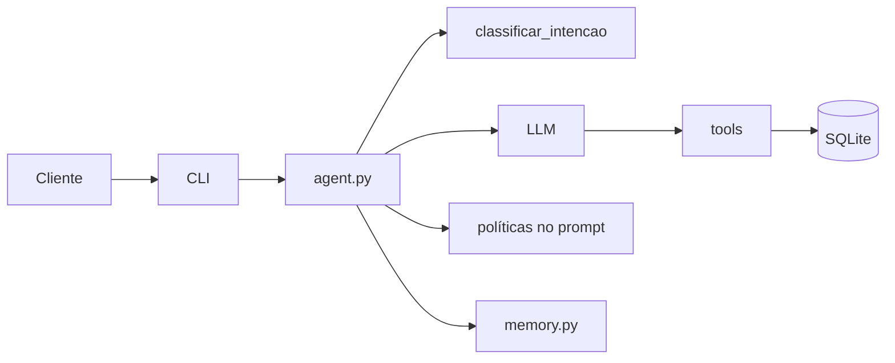

<!-- Responsabilidade: descrever a arquitetura do agente do Empório da Música, fluxos e decisões de implementação. -->

# Arquitetura do Empório Agente

## Visão geral

O agente é um fluxo simples: o cliente interage via CLI, o núcleo do agente decide se precisa de uma tool ou da política, consulta dados do SQLite e responde em texto. Toda operação sensível passa por validação, separação de leitura/escrita e filtros específicos de segurança.

## Fluxo de uma mensagem

1. A mensagem chega por CLI ou integração futura.
2. O classificador decide se a mensagem está no escopo.
3. O agente monta o prompt com tools, persona, manual, histórico e mensagem nova.
4. O provedor escolhido responde e pode requisitar tool calls.
5. Tools consultam SQLite apenas por leitura e retornam objetos estruturados.
6. O agente combina resultado da tool com regras internas e responde ao cliente.
7. O histórico e tool calls são registrados em `memory.py`.

## Responsabilidade por módulo

- `config.py`: leitura do `.env`, `hoje()` e configuração central.
- `db.py`: conexões, authorizer e regras de segurança do banco.
- `schema.sql`: estrutura de SQLite da loja + agent.
- `schemas.py`: modelos Pydantic para argumentos das tools.
- `prompts.py`: rascunho de persona, regras e formato da resposta.
- `llm.py`: provedor principal e fallback.
- `agent.py`: loop principal do agente.
- `intent.py`: `classificar_intencao(msg)`.
- `policies.py`: encapsula o manual em `get_policy_context()`.
- `memory.py`: histórico e logs.
- `cli.py`: entrada de texto por linha de comando.
- `tools/`: implementações fixas para catálogo, promoções e pedidos.

## Modelo de dados

- Tabelas da loja: `categories`, `products`, `promotions`, `customers`, `orders`, `order_items`.
- Tabelas do agente: `conversations`, `messages`, `tool_calls`.
- Dados do cliente só são consultados após verificação do pedido e e-mail.
- A sessão mantém o `customer_id` validado, sem depender do modelo.

## Segurança em camadas

- Conexão de leitura somente para tools.
- `set_authorizer` bloqueia acesso indevido a colunas e consultas.
- `SELECT *` é proibido.
- `customer_id` não é argumento vindo do modelo.
- `description_raw`, telefone e e-mail não são expostos pela API do agente.
- `hoje()` centraliza a data para evitar inconsistência em datas de referência.

## Decisões e trade-offs

- Function calling direto foi preferido a frameworks para manter o controle do loop e reduzir abstração.
- Prompt em memória e inline foi escolhido porque o manual cabe com folga; em escala futura, RAG pode substituir a cópia completa.
- SQLite único facilita a execução local e minimiza complexidade de infra.
- Tools com argumentos fixos evitam text-to-SQL e reduzem variáveis de interpretação humana.

## Em aberto

- RAG com busca híbrida BM25 + embeddings.
- FastAPI e login real.
- Resumo de contexto, janela de histórico e classificação de intenção mais robusta.

## Evolução

- RAG e políticas por seção.
- FastAPI em camada de entrada.
- Autenticação real em WhatsApp ou login OTP.
- Melhor classificação de intenção com conjunto de teste e reevaluar a estratégia de fallback do LLM.
